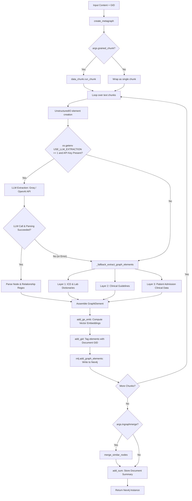

# Comprehensive Analysis of `create_graph.py`

This document provides a line-by-line explanation of [`create_graph.py`](file:///home/bruh/Documents/GraphRAG/create_graph.py), detailing its purpose, architecture, algorithms, data structures, and every single line of code (Lines 1 to 777).

---

## 1. Executive Summary & Architectural Role

In the **GraphRAG** pipeline, [`create_graph.py`](file:///home/bruh/Documents/GraphRAG/create_graph.py) serves as the primary engine that transforms unstructured and semi-structured clinical text into rich, typed property graphs stored in Neo4j.

The file bridges raw data ingestion with graph storage, implementing:
1. **Dual-Path Extraction Architecture**:
   - **LLM-Based Path** (`_extract_graph_elements_from_text`): Leverages an OpenAI-compatible API (e.g., Groq, OpenAI, OpenRouter with `llama-3.3-70b-versatile`) to perform clinical entity extraction and relation extraction adhering to strict medical ontologies.
   - **Deterministic Structured Rule-Based Fallback Path** (`_fallback_extract_graph_elements`): A domain-aware medical graph builder driven by regular expressions and clinical lexicons. It operates across three distinct clinical data layers (Dictionary/Ontology, Clinical Guidelines, and Patient Admissions/MIMIC data).
2. **Anti-Hub Design Philosophy**:
   - Standard biomedical graph extractors often connect all entities to a central `Patient` hub or a single primary diagnosis. This causes severe graph densification and degrades GraphRAG path search and retrieval quality.
   - [`create_graph.py`](file:///home/bruh/Documents/GraphRAG/create_graph.py) strictly avoids hub-and-spoke topologies by enforcing **distributed inter-entity relationships**, **linear chaining** (instead of $O(n^2)$ cliques), **round-robin edge assignments**, and limiting the patient node to a single anchor edge.
3. **Graph Enrichment & Neo4j Ingestion Orchestrator** (`create_metagraph`):
   - Chunks input text (optionally using fine-grained semantic chunking).
   - Generates vector embeddings for nodes and relationships (`add_ge_emb`).
   - Associates every element with a unique document Graph ID (`add_gid`).
   - Persists graph elements to Neo4j.
   - Executes optional semantic in-graph node merging (`merge_similar_nodes`).
   - Generates document-level chunk summaries and persists them (`add_sum`).

---

## 2. Global Architecture & Pipeline Flow



---

## 3. Detailed Line-by-Line Explanation

### Lines 1–15: Module Imports and Environment Configuration

```python
1: import os
2: import re
3: 
4: from openai import OpenAI
5: from camel.loaders import UnstructuredIO
6: from camel.storages.graph_storages.graph_element import GraphElement, Node, Relationship
7: 
8: from utils import add_ge_emb, add_gid, merge_similar_nodes, add_sum
9: 
10: try:
11:     from dotenv import load_dotenv
12:     load_dotenv()
13: except ImportError:
14:     pass
15: 
```

- **Line 1 (`import os`)**: Imports the standard operating system interface module. Used to read environment variables (`os.getenv`) such as `USE_LLM_EXTRACTION`, `GROQ_API_KEY`, `OPENAI_API_KEY`, `OPENAI_MODEL`, etc.
- **Line 2 (`import re`)**: Imports the regular expression library, foundational to parsing LLM output and executing all tokenization/extraction patterns in the rule-based fallback.
- **Line 3**: Blank line separating standard library imports from third-party imports.
- **Line 4 (`from openai import OpenAI`)**: Imports the official OpenAI client SDK. Used to communicate with OpenAI-compatible endpoints (Groq, OpenRouter, OpenAI) for LLM-based entity and relation extraction.
- **Line 5 (`from camel.loaders import UnstructuredIO`)**: Imports `UnstructuredIO` from CAMEL-AI, which converts raw text strings into structured text elements holding metadata.
- **Line 6 (`from camel.storages.graph_storages.graph_element import GraphElement, Node, Relationship`)**: Imports CAMEL's graph schema classes:
  - `Node`: Represents a knowledge graph entity with `id`, `type`, and key-value `properties`.
  - `Relationship`: Represents a directed edge connecting `subj` (subject Node) to `obj` (object Node) with a relationship `type` and `properties`.
  - `GraphElement`: Encapsulates collections of `Node`s and `Relationship`s along with their origin `source` document element.
- **Line 7**: Blank line.
- **Line 8 (`from utils import add_ge_emb, add_gid, merge_similar_nodes, add_sum`)**: Imports custom utility functions from local [`utils.py`](file:///home/bruh/Documents/GraphRAG/utils.py):
  - `add_ge_emb`: Computes and attaches vector embeddings to graph elements.
  - `add_gid`: Tags all nodes and edges with a unique document Graph ID (`gid`).
  - `merge_similar_nodes`: Merges semantically equivalent nodes within the graph using embeddings/graph topology.
  - `add_sum`: Generates and persists a chunk-level semantic summary in Neo4j.
- **Line 9**: Blank line.
- **Lines 10–14 (`try ... from dotenv import load_dotenv ... load_dotenv() ... except ImportError: pass`)**: Gracefully attempts to load environment variables from a `.env` file using `python-dotenv`. If `dotenv` is not installed, it catches `ImportError` and continues silently without crashing, relying on system environment variables.
- **Lines 15–16**: Blank formatting lines.

---

### Lines 17–37: Medical Knowledge Graph System Prompt (`KG_SYSTEM_PROMPT`)

```python
17: KG_SYSTEM_PROMPT = (
18:     "You are a medical knowledge graph extraction engine. "
19:     "Given clinical text, extract TYPED medical entities and the relationships BETWEEN them. "
20:     "Do NOT create a central Patient hub node that connects to everything. "
21:     "Instead, create direct relationships between medical concepts.\n\n"
22:     "Entity types to use: Disease, Symptom, Medication, Medical_Test, Procedure, "
23:     "Condition, Anatomy, Measurement, Diagnosis, LabTest, Hormone, Clinical_Finding\n\n"
24:     "Relationship types to use: treats, caused_by, detects, associated_with, "
25:     "prescribed_for, performed_for, indicates, monitors, contraindicates, "
26:     "complication_of, symptom_of, diagnosed_by, administered_via, "
27:     "measured_by, affects, produces, risk_factor_for\n\n"
28:     "Return ONLY lines in these exact formats:\n"
29:     "Node(id='ENTITY_NAME', type='TYPE', description='BRIEF_DESCRIPTION')\n"
30:     "Relationship(subj=Node(id='S', type='ST'), obj=Node(id='O', type='OT'), type='REL_TYPE')\n\n"
31:     "Example output:\n"
32:     "Node(id='Vascular Dementia', type='Disease', description='A form of dementia caused by impaired blood flow to the brain')\n"
33:     "Node(id='MRI', type='Medical_Test', description='Imaging technique showing structural brain changes')\n"
34:     "Node(id='Chronic Ischemic Damage', type='Condition', description='Brain damage due to reduced blood supply')\n"
35:     "Relationship(subj=Node(id='Vascular Dementia', type='Disease'), obj=Node(id='Chronic Ischemic Damage', type='Condition'), type='caused_by')\n"
36:     "Relationship(subj=Node(id='MRI', type='Medical_Test'), obj=Node(id='Chronic Ischemic Damage', type='Condition'), type='detects')\n"
37: )
```

- **Lines 17–21**: Defines the persona and core objective. Critically instructs the LLM: **"Do NOT create a central Patient hub node that connects to everything. Instead, create direct relationships between medical concepts."** This is the core anti-hub prompt constraint.
- **Lines 22–23**: Constrains the entity ontology to 12 canonical clinical types: `Disease`, `Symptom`, `Medication`, `Medical_Test`, `Procedure`, `Condition`, `Anatomy`, `Measurement`, `Diagnosis`, `LabTest`, `Hormone`, `Clinical_Finding`.
- **Lines 24–27**: Constrains edge predicates to 17 medical relations: `treats`, `caused_by`, `detects`, `associated_with`, `prescribed_for`, `performed_for`, `indicates`, `monitors`, `contraindicates`, `complication_of`, `symptom_of`, `diagnosed_by`, `administered_via`, `measured_by`, `affects`, `produces`, `risk_factor_for`.
- **Lines 28–30**: Strictly specifies the output format grammar so deterministic regex can parse the LLM completion:
  - `Node(id='...', type='...', description='...')`
  - `Relationship(subj=Node(id='...', type='...'), obj=Node(id='...', type='...'), type='...')`
- **Lines 31–37**: Few-shot example demonstrating nodes with brief descriptions and direct inter-concept relationships (e.g. `Vascular Dementia` --`caused_by`--> `Chronic Ischemic Damage`, `MRI` --`detects`--> `Chronic Ischemic Damage`).
- **Lines 38–41**: Blank formatting lines.

---

### Lines 42–80: LLM Extraction Routine (`_extract_graph_elements_from_text`)

```python
42: def _extract_graph_elements_from_text(raw_text, source_element):
43:     if os.getenv("USE_LLM_EXTRACTION", "0") != "1":
44:         return _fallback_extract_graph_elements(raw_text, source_element)
45: 
46:     api_key = os.getenv("GROQ_API_KEY") or os.getenv("OPENAI_API_KEY") or os.getenv("OPENROUTER_API_KEY")
47:     if not api_key:
48:         return _fallback_extract_graph_elements(raw_text, source_element)
49: 
50:     model = os.getenv("GROQ_MODEL") or os.getenv("OPENAI_MODEL", "llama-3.3-70b-versatile")
51:     base_url = os.getenv("OPENAI_API_BASE_URL", "https://api.groq.com/openai/v1")
52: 
53:     user_prompt = (
54:         "Extract typed medical entities and the direct relationships between them. "
55:         "Do NOT make a Patient node the center of every relationship. "
56:         "Focus on medical concept interconnections.\n\n"
57:         f"CONTENT:\n{raw_text}"
58:     )
59: 
60:     try:
61:         client = OpenAI(
62:             api_key=api_key,
63:             base_url=base_url,
64:             timeout=30,
65:             max_retries=0,
66:         )
67:         response = client.chat.completions.create(
68:             model=model,
69:             messages=[
70:                 {"role": "system", "content": KG_SYSTEM_PROMPT},
71:                 {"role": "user", "content": user_prompt},
72:             ],
73:             max_tokens=1200,
74:             temperature=0.0,
75:             timeout=45,
76:         )
77:         content = response.choices[0].message.content or ""
78:     except Exception:
79:         return _fallback_extract_graph_elements(raw_text, source_element)
```

- **Line 42**: Function declaration taking `raw_text` (chunk text string) and `source_element` (CAMEL Element object for source attribution).
- **Lines 43–44**: Checks environment variable `USE_LLM_EXTRACTION`. If not explicitly set to `"1"`, it bypasses the LLM entirely and immediately returns the result of `_fallback_extract_graph_elements`.
- **Line 45**: Blank line.
- **Lines 46–48**: Checks available API keys with fallback precedence: `GROQ_API_KEY` $\rightarrow$ `OPENAI_API_KEY` $\rightarrow$ `OPENROUTER_API_KEY`. If no key is set, falls back to rule-based extraction.
- **Line 49**: Blank line.
- **Line 50**: Determines the LLM model name. Checks `GROQ_MODEL`, then `OPENAI_MODEL`, defaulting to `"llama-3.3-70b-versatile"`.
- **Line 51**: Sets `base_url`, defaulting to Groq's endpoint (`https://api.groq.com/openai/v1`) or the override from `OPENAI_API_BASE_URL`.
- **Line 52**: Blank line.
- **Lines 53–58**: Constructs `user_prompt` by reiterating the anti-hub constraint and appending the raw clinical chunk under `CONTENT:\n`.
- **Line 59**: Blank line.
- **Lines 60–66**: Initializes the `OpenAI` client with `api_key`, `base_url`, 30s connection timeout, and `max_retries=0` (fails fast on rate limits/network glitches rather than blocking the batch pipeline).
- **Lines 67–76**: Dispatches `client.chat.completions.create`:
  - `model`: Selected LLM model.
  - `messages`: System prompt + User prompt.
  - `max_tokens=1200`: Accommodates dense entity/edge declarations.
  - `temperature=0.0`: Enforces deterministic extraction.
  - `timeout=45`: Read timeout of 45 seconds.
- **Line 77**: Extracts completion text safely, falling back to empty string `""` if content is None.
- **Lines 78–79**: Wraps client initialization and completion in a broad `try-except` block. If any network failure, timeout, auth error, or rate-limit exception occurs, it seamlessly returns `_fallback_extract_graph_elements(raw_text, source_element)`.
- **Line 80**: Blank line.

---

### Lines 81–106: Parsing LLM Extracted Nodes

```python
81:     # Parse nodes — with optional description field
82:     node_pattern = r"Node\(id='(.*?)', type='(.*?)'(?:, description='(.*?)')?\)"
83:     rel_pattern = (
84:         r"Relationship\(subj=Node\(id='(.*?)', type='(.*?)'\), "
85:         r"obj=Node\(id='(.*?)', type='(.*?)'\), type='(.*?)'\)"
86:     )
87: 
88:     nodes = {}
89:     relationships = []
90: 
91:     for match in re.finditer(node_pattern, content):
92:         node_id, node_type = match.group(1).strip(), match.group(2).strip()
93:         node_desc = (match.group(3) or "").strip()
94:         node_type = node_type or "Entity"
95:         if node_id and node_id not in nodes:
96:             props = {
97:                 "source": "llm_extracted",
98:                 "source_type": "LLM_extracted",
99:                 "modality": "clinical_text",
100:                 "extraction_confidence": "medium",
101:                 "extraction_method": "llm_extraction"
102:             }
103:             if node_desc:
104:                 props["description"] = node_desc
105:             nodes[node_id] = Node(id=node_id, type=node_type, properties=props)
106: 
```

- **Line 81**: Comment explaining node parsing with optional description support.
- **Line 82**: Compiles regular expression for nodes: `Node\(id='(.*?)', type='(.*?)'(?:, description='(.*?)')?\)`. Group 1 captures entity ID, Group 2 captures entity type, and optional Group 3 captures the description text.
- **Lines 83–86**: Compiles regular expression for relationships: `Relationship\(subj=Node\(id='(.*?)', type='(.*?)'\), obj=Node\(id='(.*?)', type='(.*?)'\), type='(.*?)'\)`. Matches subject ID, subject type, object ID, object type, and relation predicate.
- **Line 87**: Blank line.
- **Lines 88–89**: Initializes `nodes = {}` (dictionary keyed by entity ID to prevent duplicate nodes) and `relationships = []` (list of `Relationship` objects).
- **Line 90**: Blank line.
- **Line 91**: Iterates over all regex matches of `node_pattern` in the LLM `content`.
- **Line 92**: Extracts and strips whitespace from `node_id` (Group 1) and `node_type` (Group 2).
- **Line 93**: Extracts Group 3 (`node_desc`), defaulting to empty string if absent, and strips whitespace.
- **Line 94**: Defaults `node_type` to `"Entity"` if an empty type was extracted.
- **Line 95**: Ensures `node_id` is non-empty and has not already been added to the `nodes` dictionary (deduplication).
- **Lines 96–102**: Creates standard metadata dictionary `props` with provenance and confidence attributes:
  - `"source": "llm_extracted"`
  - `"source_type": "LLM_extracted"`
  - `"modality": "clinical_text"`
  - `"extraction_confidence": "medium"`
  - `"extraction_method": "llm_extraction"`
- **Lines 103–104**: If `node_desc` is present, adds it to `props["description"]`.
- **Line 105**: Instantiates CAMEL `Node(id=node_id, type=node_type, properties=props)` and stores it in `nodes[node_id]`.
- **Line 106**: Blank line.

---

### Lines 107–156: Parsing LLM Extracted Relationships

```python
107:     for match in re.finditer(rel_pattern, content):
108:         subj_id, subj_type, obj_id, obj_type, rel_type = match.groups()
109:         subj_id = subj_id.strip()
110:         obj_id = obj_id.strip()
111:         subj_type = subj_type.strip() or "Entity"
112:         obj_type = obj_type.strip() or "Entity"
113:         rel_type = rel_type.strip() or "RELATED_TO"
114: 
115:         if not subj_id or not obj_id:
116:             continue
117: 
118:         if subj_id not in nodes:
119:             nodes[subj_id] = Node(
120:                 id=subj_id,
121:                 type=subj_type,
122:                 properties={
123:                     "source": "llm_extracted",
124:                     "source_type": "LLM_extracted",
125:                     "modality": "clinical_text",
126:                     "extraction_confidence": "medium",
127:                     "extraction_method": "llm_extraction"
128:                 },
129:             )
130:         if obj_id not in nodes:
131:             nodes[obj_id] = Node(
132:                 id=obj_id,
133:                 type=obj_type,
134:                 properties={
135:                     "source": "llm_extracted",
136:                     "source_type": "LLM_extracted",
137:                     "modality": "clinical_text",
138:                     "extraction_confidence": "medium",
139:                     "extraction_method": "llm_extraction"
140:                 },
141:             )
142: 
143:         relationships.append(
144:             Relationship(
145:                 subj=nodes[subj_id],
146:                 obj=nodes[obj_id],
147:                 type=rel_type,
148:                 properties={
149:                     "source": "llm_extracted",
150:                     "source_type": "LLM_extracted",
151:                     "provenance": "evidence_backed",
152:                     "extraction_method": "llm_relation_extraction"
153:                 },
154:             )
155:         )
156: 
```

- **Line 107**: Scans `content` for all occurrences of `rel_pattern`.
- **Line 108**: Unpacks the 5 regex capture groups: `subj_id`, `subj_type`, `obj_id`, `obj_type`, `rel_type`.
- **Lines 109–113**: Strips whitespace and provides safe defaults: types default to `"Entity"`, predicate defaults to `"RELATED_TO"`.
- **Line 114**: Blank line.
- **Lines 115–116**: Skips the match if either subject or object identifier is blank.
- **Line 117**: Blank line.
- **Lines 118–129**: Dynamic subject node creation: If the LLM declared a relationship referencing a `subj_id` that was not explicitly declared in a prior `Node(...)` declaration, creates and registers it in `nodes` with standard LLM extraction metadata.
- **Lines 130–141**: Dynamic object node creation: Similarly checks `obj_id` in `nodes`, creating the `Node` if it was not previously registered.
- **Line 142**: Blank line.
- **Lines 143–155**: Instantiates CAMEL `Relationship`:
  - `subj=nodes[subj_id]`
  - `obj=nodes[obj_id]`
  - `type=rel_type`
  - `properties`: provenance metadata tagging (`source: "llm_extracted"`, `source_type: "LLM_extracted"`, `provenance: "evidence_backed"`, `extraction_method: "llm_relation_extraction"`). Appends to `relationships` list.
- **Line 156**: Blank line.

---

### Lines 157–165: GraphElement Assembly & Fallback Guard

```python
157:     graph_element = GraphElement(
158:         nodes=list(nodes.values()),
159:         relationships=relationships,
160:         source=source_element,
161:     )
162:     if not graph_element.nodes:
163:         return _fallback_extract_graph_elements(raw_text, source_element)
164:     return graph_element
165: 
```

- **Lines 157–161**: Packages all extracted nodes (`list(nodes.values())`) and relationships into a `GraphElement`, linking it to `source=source_element`.
- **Lines 162–163**: Safeguard: If the LLM returned empty content or hallucinations that could not be parsed by regex (resulting in 0 nodes), it falls back to `_fallback_extract_graph_elements(raw_text, source_element)`.
- **Line 164**: Returns the successfully constructed `graph_element`.
- **Lines 165–166**: Blank formatting lines.

---

### Lines 167–171: ICD Chapter Prefix Helper (`_icd_chapter`)

```python
167: def _icd_chapter(code_str):
168:     """Extract the ICD chapter prefix (first 3 chars) for grouping."""
169:     code = re.sub(r"[^A-Za-z0-9]", "", code_str.strip())
170:     return code[:3] if len(code) >= 3 else code
171: 
```

- **Line 167**: Defines function `_icd_chapter(code_str)` which normalizes an ICD code to its categorical chapter/category block.
- **Line 168**: Docstring explaining extraction of the first 3 alphanumeric characters.
- **Line 169**: Strips periods, hyphens, and whitespace using regex `[^A-Za-z0-9]` (e.g. `"I25.10"` $\rightarrow$ `"I2510"`, `"04.81"` $\rightarrow$ `"0481"`).
- **Line 170**: Returns the 3-character prefix if length is $\ge 3$ (e.g., `"I25"` or `"048"`), else returns the full stripped string.
- **Lines 171–172**: Blank formatting lines.

---

### Lines 173–260: Structured Fallback Engine Initialization & Lexicons

```python
173: def _fallback_extract_graph_elements(raw_text, source_element):
174:     """Structured fallback: build a medical knowledge graph from structured
175:     clinical text.  Creates a distributed mesh of inter-entity relationships
176:     rather than a patient-centric star or any single hub node.
177:     """
178:     nodes = {}
179:     relationships = []
180: 
181:     # ---- Clinical type classification keywords ----
182:     _DISEASE_KEYWORDS = {
183:         "pneumonia", "tuberculosis", "sepsis", "meningitis", "endocarditis",
184:         "cellulitis", "osteomyelitis", "bronchitis", "influenza", "hepatitis",
185:         "encephalitis", "pericarditis", "peritonitis", "abscess", "empyema",
186:         "bacteremia", "colitis", "gastroenteritis", "pharyngitis", "sinusitis",
187:         "tonsillitis", "otitis", "cystitis", "pyelonephritis", "cholecystitis",
188:         "pancreatitis", "diverticulitis", "arthritis", "myocarditis",
189:         "cardiomyopathy", "fibrosis", "cirrhosis", "neoplasm", "cancer",
190:         "tumor", "malignancy", "lymphoma", "leukemia", "sarcoma",
191:         "diabetes", "asthma", "copd", "emphysema",
192:     }
193:     _CONDITION_KEYWORDS = {
194:         "failure", "insufficiency", "disorder", "syndrome", "dysfunction",
195:         "deficiency", "overload", "imbalance", "abnormality", "deformity",
196:         "stenosis", "obstruction", "blockage", "occlusion", "thrombosis",
197:         "embolism", "hemorrhage", "effusion", "edema", "hypertension",
198:         "hypotension", "tachycardia", "bradycardia", "arrhythmia",
199:         "fibrillation", "anemia", "acidosis", "alkalosis", "hyperkalemia",
200:         "hyperpotassemia", "hyponatremia", "hyperglycemia", "hypoglycemia",
201:     }
202:     _SYMPTOM_KEYWORDS = {
203:         "pain", "fever", "cough", "dyspnea", "nausea", "vomiting",
204:         "diarrhea", "fatigue", "weakness", "dizziness", "headache",
205:         "swelling", "rash", "pruritus", "bleeding", "hemoptysis",
206:         "wheezing", "stridor", "confusion", "syncope", "palpitation",
207:         "restless", "insomnia", "malaise", "chills", "rigors", "tremor",
208:         "paresthesia", "numbness", "dysphagia", "constipation",
209:     }
210:     _ANATOMY_KEYWORDS = {
211:         "lung", "heart", "liver", "kidney", "brain", "artery", "vein",
212:         "lobe", "ventricle", "atrium", "aorta", "bronchus", "pleura",
213:         "peritoneum", "mediastinum", "thorax", "abdomen", "pelvis",
214:         "femur", "tibia", "spine", "vertebra", "cortex", "cerebral",
215:         "pulmonary", "hepatic", "renal", "cardiac", "cranial",
216:         "axillary", "carotid", "femoral", "pericardial",
217:     }
218:     _INFECTION_KEYWORDS = {
219:         "infection", "infectious", "infected", "septic", "mrsa",
220:         "vre", "esbl", "c. diff", "clostridium", "candida", "fungal",
221:         "viral", "bacterial",
222:     }
223:     _INJURY_KEYWORDS = {
224:         "fracture", "dislocation", "sprain", "strain", "contusion",
225:         "laceration", "wound", "burn", "injury", "trauma", "rupture",
226:         "tear", "amputation", "bite", "crushing", "concussion",
227:     }
```

- **Lines 173–177**: Defines `_fallback_extract_graph_elements(raw_text, source_element)` with a docstring emphasizing the generation of a **distributed mesh** rather than a star topology.
- **Lines 178–179**: Initializes `nodes = {}` and `relationships = []`.
- **Line 180**: Blank line.
- **Lines 181–228**: Defines 6 comprehensive sets of medical classification keywords:
  - `_DISEASE_KEYWORDS` (Lines 182–192): Specific clinical diseases and malignancies (e.g., pneumonia, sepsis, diabetes, leukemia).
  - `_CONDITION_KEYWORDS` (Lines 193–201): Pathophysiological states, syndromes, and organ dysfunctions (e.g., failure, stenosis, thrombosis, acidosis, hypertension).
  - `_SYMPTOM_KEYWORDS` (Lines 202–209): Patient-reported symptoms and observable clinical signs (e.g., dyspnea, pain, syncope, paresthesia).
  - `_ANATOMY_KEYWORDS` (Lines 210–217): Anatomical organs, structures, and regions (e.g., lung, aorta, peritoneum, femur).
  - `_INFECTION_KEYWORDS` (Lines 218–222): Infection markers, pathogens, and resistance acronyms (e.g., mrsa, vre, clostridium, fungal).
  - `_INJURY_KEYWORDS` (Lines 223–227): Traumatic injuries and physical damage (e.g., fracture, laceration, contusion, concussion).
- **Line 228**: Blank line.

---

### Lines 229–260: Clinical Classification (`_classify_diagnosis`) and Node Builder (`_add_node`)

```python
229:     def _classify_diagnosis(name):
230:         """Classify a diagnosis string into a specific entity type."""
231:         name_lower = name.lower()
232:         if any(kw in name_lower for kw in _DISEASE_KEYWORDS):
233:             return "Disease"
234:         if any(kw in name_lower for kw in _INFECTION_KEYWORDS):
235:             return "Infection"
236:         if any(kw in name_lower for kw in _INJURY_KEYWORDS):
237:             return "Condition"
238:         if any(kw in name_lower for kw in _SYMPTOM_KEYWORDS):
239:             return "Symptom"
240:         if any(kw in name_lower for kw in _CONDITION_KEYWORDS):
241:             return "Condition"
242:         if any(kw in name_lower for kw in _ANATOMY_KEYWORDS):
243:             return "Anatomy"
244:         return "Condition"  # default to Condition rather than generic Diagnosis
245: 
246:     def _add_node(node_id, node_type, description="", source_type="rule_based", modality="structured_data", confidence="high"):
247:         key = node_id.strip()
248:         if key and key not in nodes:
249:             props = {
250:                 "source": "structured_fallback",
251:                 "source_type": source_type,
252:                 "modality": modality,
253:                 "extraction_confidence": confidence,
254:                 "extraction_method": "structured_rule_fallback"
255:             }
256:             if description:
257:                 props["description"] = description
258:             nodes[key] = Node(id=key, type=node_type, properties=props)
259:         return nodes.get(key)
260: 
```

- **Lines 229–245 (`_classify_diagnosis`)**:
  - Takes a clinical name string, converts to lowercase (`name_lower = name.lower()`).
  - Checks keywords sequentially against the defined dictionaries:
    - Disease keywords $\rightarrow$ returns `"Disease"`
    - Infection keywords $\rightarrow$ returns `"Infection"`
    - Injury keywords $\rightarrow$ returns `"Condition"`
    - Symptom keywords $\rightarrow$ returns `"Symptom"`
    - Condition keywords $\rightarrow$ returns `"Condition"`
    - Anatomy keywords $\rightarrow$ returns `"Anatomy"`
  - Line 244: Defaults to `"Condition"` instead of a generic untyped `"Diagnosis"` string, maintaining strong ontological typing.
- **Lines 246–260 (`_add_node`)**:
  - Centralized helper to create nodes idempotently.
  - Arguments: `node_id`, `node_type`, optional `description`, and metadata tags (`source_type`, `modality`, `confidence`).
  - Strips whitespace to form `key`.
  - If `key` is non-empty and not in `nodes`, builds `props` dict and constructs `Node(id=key, type=node_type, properties=props)`.
  - Line 259: Always returns the existing or newly created node reference (`nodes.get(key)`).
- **Line 260**: Blank line.

---

### Lines 261–295: Layer 1A: ICD Diagnosis Dictionary Parsing and Chapter Chaining

```python
261:     # =====================================================================
262:     # 1) DICTIONARY DATA  (bottom / middle layer)
263:     #    Create clustered sub-graphs using ICD code grouping.
264:     #    Classify diagnoses into Disease / Condition / Symptom / Infection.
265:     # =====================================================================
266: 
267:     # --- Diagnosis dictionary entries ---
268:     icd_diag_groups = {}  # chapter_prefix -> list of nodes
269:     for match in re.finditer(
270:         r"DIAGNOSIS\s+code=(\S+)\s+icd_version=(\S+)\s+name=(.+?)(?:\n|$)", raw_text
271:     ):
272:         code, ver, name = match.group(1), match.group(2), match.group(3).strip()
273:         entity_type = _classify_diagnosis(name)
274:         d_node = _add_node(name, entity_type, f"ICD-{ver} code {code}: {name}")
275:         chapter = _icd_chapter(code)
276:         icd_diag_groups.setdefault(chapter, []).append(d_node)
277: 
278:     # Link diagnoses within the same ICD chapter (chain rather than clique)
279:     for chapter, group_nodes in icd_diag_groups.items():
280:         for i in range(len(group_nodes) - 1):
281:             relationships.append(
282:                 Relationship(
283:                     subj=group_nodes[i],
284:                     obj=group_nodes[i + 1],
285:                     type="icd_related",
286:                     properties={
287:                         "source": "structured_fallback",
288:                         "source_type": "dictionary",
289:                         "provenance": "dictionary_derived",
290:                         "extraction_method": "icd_chapter_grouping",
291:                         "icd_chapter": chapter
292:                     },
293:                 )
294:             )
295: 
```

- **Lines 261–267**: Section banner and comments documenting bottom/middle layer dictionary processing.
- **Line 268**: Initializes `icd_diag_groups = {}` mapping `chapter_prefix -> list of nodes`.
- **Lines 269–271**: Regex iterator scanning for structured diagnosis lines:
  `DIAGNOSIS\s+code=(\S+)\s+icd_version=(\S+)\s+name=(.+?)(?:\n|$)`.
- **Line 272**: Unpacks `code`, `ver`, `name`.
- **Line 273**: Calls `_classify_diagnosis(name)` to determine specific entity type.
- **Line 274**: Creates diagnosis node with formatted description `ICD-{ver} code {code}: {name}`.
- **Line 275**: Computes ICD chapter prefix (e.g. `I25`).
- **Line 276**: Groups node under `icd_diag_groups[chapter]`.
- **Line 277**: Blank line.
- **Lines 278–294**: **Linear Chaining Algorithm**:
  - Rather than forming an $O(n^2)$ full clique between all diagnoses in an ICD chapter, it connects `group_nodes[i]` $\rightarrow$ `group_nodes[i+1]` in a directed sequence (`icd_related`).
  - Attaches properties including `"icd_chapter": chapter`.
  - Keeps edge count linear ($O(n)$) while preserving graph reachability.
- **Line 295**: Blank line.

---

### Lines 296–322: Layer 1B: ICD Procedure Dictionary Parsing and Chapter Chaining

```python
296:     # --- Procedure dictionary entries ---
297:     icd_proc_groups = {}
298:     for match in re.finditer(
299:         r"PROCEDURE\s+code=(\S+)\s+icd_version=(\S+)\s+name=(.+?)(?:\n|$)", raw_text
300:     ):
301:         code, ver, name = match.group(1), match.group(2), match.group(3).strip()
302:         p_node = _add_node(name, "Procedure", f"ICD-{ver} procedure code {code}: {name}", source_type="dictionary", modality="dictionary")
303:         chapter = _icd_chapter(code)
304:         icd_proc_groups.setdefault(chapter, []).append(p_node)
305: 
306:     for chapter, group_nodes in icd_proc_groups.items():
307:         for i in range(len(group_nodes) - 1):
308:             relationships.append(
309:                 Relationship(
310:                     subj=group_nodes[i],
311:                     obj=group_nodes[i + 1],
312:                     type="icd_related",
313:                     properties={
314:                         "source": "structured_fallback",
315:                         "source_type": "dictionary",
316:                         "provenance": "dictionary_derived",
317:                         "extraction_method": "icd_chapter_grouping",
318:                         "icd_chapter": chapter
319:                     },
320:                 )
321:             )
322: 
```

- **Lines 296–297**: Initializes `icd_proc_groups = {}`.
- **Lines 298–300**: Regex iterator scanning for procedure dictionary entries:
  `PROCEDURE\s+code=(\S+)\s+icd_version=(\S+)\s+name=(.+?)(?:\n|$)`.
- **Line 301**: Extracts `code`, `ver`, `name`.
- **Line 302**: Calls `_add_node(name, "Procedure", ...)` with dictionary source attribution.
- **Line 303**: Extracts chapter prefix via `_icd_chapter(code)`.
- **Line 304**: Appends `p_node` to `icd_proc_groups[chapter]`.
- **Line 305**: Blank line.
- **Lines 306–321**: Iterates over each procedure chapter group and constructs sequential `icd_related` edges from node $i$ to node $i+1$.
- **Line 322**: Blank line.

---

### Lines 323–357: Layer 1C: Lab Test Dictionary Parsing and Fluid-Category Chaining

```python
323:     # --- Lab dictionary entries ---
324:     lab_category_groups = {}
325:     for match in re.finditer(
326:         r"LAB_TEST\s+itemid=(\S+)\s+label=(.+?)\s+fluid=(\S+)\s+category=(.+?)(?:\n|$)",
327:         raw_text,
328:     ):
329:         itemid, label, fluid, category = (
330:             match.group(1),
331:             match.group(2).strip(),
332:             match.group(3).strip(),
333:             match.group(4).strip(),
334:         )
335:         desc = f"Lab test (item {itemid}): {label}, fluid={fluid}, category={category}"
336:         l_node = _add_node(label, "LabTest", desc, source_type="dictionary", modality="dictionary")
337:         group_key = f"{fluid}_{category}"
338:         lab_category_groups.setdefault(group_key, []).append(l_node)
339: 
340:     # Chain labs within the same category
341:     for group_key, group_nodes in lab_category_groups.items():
342:         for i in range(len(group_nodes) - 1):
343:             relationships.append(
344:                 Relationship(
345:                     subj=group_nodes[i],
346:                     obj=group_nodes[i + 1],
347:                     type="same_category",
348:                     properties={
349:                         "source": "structured_fallback",
350:                         "source_type": "dictionary",
351:                         "provenance": "dictionary_derived",
352:                         "extraction_method": "lab_category_chain",
353:                         "category": group_key
354:                     },
355:                 )
356:             )
357: 
```

- **Line 324**: Initializes `lab_category_groups = {}` mapping `{fluid}_{category} -> list of LabTest nodes`.
- **Lines 325–328**: Matches structured lab dictionary lines:
  `LAB_TEST\s+itemid=(\S+)\s+label=(.+?)\s+fluid=(\S+)\s+category=(.+?)(?:\n|$)`.
- **Lines 329–334**: Extracts `itemid`, `label`, `fluid`, `category`.
- **Line 335**: Composes description string detailing item ID, specimen fluid, and panel category.
- **Line 336**: Creates `LabTest` node using `_add_node`.
- **Line 337**: Computes grouping composite key: `group_key = f"{fluid}_{category}"` (e.g. `Blood_Hematology`, `Urine_Chemistry`).
- **Line 338**: Groups node under `lab_category_groups[group_key]`.
- **Line 339–340**: Blank line and comment.
- **Lines 341–356**: Chains related labs sequentially within the same category using `same_category` relationships.
- **Line 357**: Blank line.

---

### Lines 358–375: Layer 1D: Cross-Chapter Bridging Between Procedures and Diagnoses

```python
358:     # Cross-link: connect each ICD diag chapter head to related procedure chapter head
359:     diag_heads = {ch: ns[0] for ch, ns in icd_diag_groups.items() if ns}
360:     proc_heads = {ch: ns[0] for ch, ns in icd_proc_groups.items() if ns}
361:     for chapter in set(diag_heads) & set(proc_heads):
362:         relationships.append(
363:             Relationship(
364:                 subj=proc_heads[chapter],
365:                 obj=diag_heads[chapter],
366:                 type="procedure_for_category",
367:                 properties={
368:                     "source": "structured_fallback",
369:                     "source_type": "dictionary",
370:                     "provenance": "dictionary_derived",
371:                     "extraction_method": "cross_chapter_link"
372:                 },
373:             )
374:         )
375: 
```

- **Line 358**: Comment explaining cross-linking between diagnosis chapter heads and procedure chapter heads.
- **Line 359**: Extracts the "head" (first node `ns[0]`) for each diagnosis chapter group (`diag_heads`).
- **Line 360**: Extracts the "head" (first node `ns[0]`) for each procedure chapter group (`proc_heads`).
- **Line 361**: Finds the intersection of chapters shared across both diagnoses and procedures (`set(diag_heads) & set(proc_heads)`).
- **Lines 362–374**: Bridges the procedure chapter head to the diagnosis chapter head via a single `procedure_for_category` edge. This links whole anatomical/disease subgraphs together without creating quadratic edge explosion.
- **Line 375**: Blank line.

---

### Lines 376–426: Layer 2: Clinical Guideline Conditions & Interventions

```python
376:     # =====================================================================
377:     # 2) GUIDELINE DATA  (middle layer)
378:     # =====================================================================
379: 
380:     guideline_conditions = []
381:     for match in re.finditer(r"Condition\s+\d+:\s+Consider diagnosis\s+'([^']+)'", raw_text):
382:         name = match.group(1).strip()
383:         g_node = _add_node(name, "Diagnosis", f"Guideline-referenced diagnosis: {name}", source_type="clinical_guideline", modality="clinical_text")
384:         guideline_conditions.append(g_node)
385: 
386:     guideline_interventions = []
387:     for match in re.finditer(r"Intervention\s+\d+:\s+Procedure option\s+'([^']+)'", raw_text):
388:         name = match.group(1).strip()
389:         g_node = _add_node(name, "Procedure", f"Guideline-referenced procedure: {name}", source_type="clinical_guideline", modality="clinical_text")
390:         guideline_interventions.append(g_node)
391: 
392:     # Round-robin link interventions to conditions (1:1 instead of many-to-many)
393:     if guideline_conditions and guideline_interventions:
394:         n_cond = len(guideline_conditions)
395:         for i, p_node in enumerate(guideline_interventions):
396:             d_node = guideline_conditions[i % n_cond]
397:             relationships.append(
398:                 Relationship(
399:                     subj=p_node,
400:                     obj=d_node,
401:                     type="indicated_for",
402:                     properties={
403:                         "source": "structured_fallback",
404:                         "source_type": "clinical_guideline",
405:                         "provenance": "structurally_generated",
406:                         "extraction_method": "guideline_round_robin"
407:                     },
408:                 )
409:             )
410: 
411:     # Chain guideline conditions (sequential, not clique)
412:     for i in range(len(guideline_conditions) - 1):
413:         relationships.append(
414:             Relationship(
415:                 subj=guideline_conditions[i],
416:                 obj=guideline_conditions[i + 1],
417:                 type="associated_with",
418:                 properties={
419:                     "source": "structured_fallback",
420:                     "source_type": "clinical_guideline",
421:                     "provenance": "structurally_generated",
422:                     "extraction_method": "guideline_condition_chain"
423:                 },
424:             )
425:         )
426: 
```

- **Lines 376–379**: Section banner for clinical guideline parsing.
- **Lines 380–385**: Parses guideline conditions using regex `Condition\s+\d+:\s+Consider diagnosis\s+'([^']+)'`. Creates `Diagnosis` nodes tagged with `source_type="clinical_guideline"`, storing them in `guideline_conditions`.
- **Lines 386–391**: Parses guideline interventions using regex `Intervention\s+\d+:\s+Procedure option\s+'([^']+)'`. Creates `Procedure` nodes tagged with `source_type="clinical_guideline"`, storing them in `guideline_interventions`.
- **Lines 392–410**: **Round-Robin Linking Algorithm**:
  - Rather than connecting every intervention to every condition ($N \times M$ dense bipartite clique), it loops over `guideline_interventions` and maps index $i$ to `guideline_conditions[i % n_cond]`.
  - Creates an `indicated_for` edge.
  - Guarantees exactly $\max(N, M)$ edges, keeping the graph sparse while connecting all elements.
- **Lines 411–425**: Sequential chain across `guideline_conditions` ($i \rightarrow i+1$) with relation `associated_with`, maintaining connectivity without forming a clique.
- **Line 426**: Blank line.

---

### Lines 427–454: Layer 3: Patient Clinical Data Header & Admission Splitting

```python
427:     # =====================================================================
428:     # 3) PATIENT CLINICAL DATA  (top layer)
429:     #    Distribute relationships evenly — NO single diagnosis hub.
430:     #    Create diverse entity types matching clinical ontology:
431:     #      Disease, Condition, Symptom, Anatomy, Measurement, Bacteria,
432:     #      Infection, Medical_Test, Clinical_Finding, Medical_Device
433:     # =====================================================================
434: 
435:     # ---- Antibiotic classification for Medication sub-typing ----
436:     _ANTIBIOTIC_KEYWORDS = {
437:         "ceftriaxone", "cefepime", "vancomycin", "meropenem", "piperacillin",
438:         "tazobactam", "azithromycin", "levofloxacin", "ciprofloxacin",
439:         "amoxicillin", "ampicillin", "metronidazole", "doxycycline",
440:         "clindamycin", "gentamicin", "tobramycin", "trimethoprim",
441:         "sulfamethoxazole", "linezolid", "daptomycin", "cefazolin",
442:         "cephalexin", "penicillin", "oxacillin", "nafcillin", "ertapenem",
443:         "imipenem", "cilastatin", "colistin", "polymyxin", "rifampin",
444:         "isoniazid", "ethambutol", "pyrazinamide",
445:     }
446: 
447:     patient_match = re.search(r"patient_id:\s*(\d+)", raw_text)
448:     patient_id = f"patient_{patient_match.group(1)}" if patient_match else None
449:     patient_node = _add_node(patient_id, "Patient") if patient_id else None
450: 
451:     # Split by admission blocks
452:     admission_blocks = re.split(r"(?=Admission summary:)", raw_text)
453: 
454:     for block in admission_blocks:
```

- **Lines 427–434**: Documentation header for patient clinical data extraction (MIMIC-IV admission records).
- **Lines 435–445 (`_ANTIBIOTIC_KEYWORDS`)**: Lexicon of 34 major antibiotic drug agents and beta-lactamase inhibitors used to sub-classify general medications into targeted antimicrobials.
- **Line 446**: Blank line.
- **Lines 447–450**: Searches for `patient_id:\s*(\d+)`. If found, creates `patient_{id}` as a `Patient` node. If not, sets `patient_node = None`.
- **Line 451**: Blank line.
- **Line 452**: Uses lookahead regex `(?=Admission summary:)` to split multi-admission patient records into discrete hospital admission chunks while retaining the delimiter.
- **Line 453**: Blank line.
- **Line 454**: Begins main iteration loop over each admission `block`.

---

### Lines 455–475: Admission Diagnoses & Procedures Extraction

```python
455:         # --- Diagnoses → classify into Disease / Condition / Symptom / Infection ---
456:         block_diagnoses = []
457:         for diag in re.findall(r"\[\d+\]\s*([^;\.\n]+)", block):
458:             d = diag.strip()
459:             if not d:
460:                 continue
461:             entity_type = _classify_diagnosis(d)
462:             d_node = _add_node(d, entity_type, f"Clinical {entity_type.lower()}: {d}")
463:             block_diagnoses.append(d_node)
464: 
465:         # --- Procedures ---
466:         block_procedures = []
467:         proc_line = re.search(r"Procedures:\s*(.*)", block)
468:         if proc_line:
469:             for proc in [p.strip() for p in proc_line.group(1).split(";") if p.strip()]:
470:                 proc_name = re.sub(r"\s+on\s+\d{4}-\d{2}-\d{2}.*", "", proc).strip()
471:                 if not proc_name:
472:                     continue
473:                 p_node = _add_node(proc_name, "Procedure", f"Medical procedure: {proc_name}")
474:                 block_procedures.append(p_node)
475: 
```

- **Lines 455–464 (Diagnoses)**:
  - Initializes `block_diagnoses = []`.
  - Scans for numbered clinical diagnosis lists: `\[\d+\]\s*([^;\.\n]+)` (matching items like `[1] Acute respiratory failure; [2] Sepsis`).
  - Cleans and strips each diagnosis `d`.
  - Passes string to `_classify_diagnosis(d)` to assign it to `Disease`, `Condition`, `Symptom`, `Infection`, or `Anatomy`.
  - Adds node via `_add_node` and appends to `block_diagnoses`.
- **Lines 465–475 (Procedures)**:
  - Initializes `block_procedures = []`.
  - Searches for `Procedures:\s*(.*)` line.
  - Splits entries by semicolon `;`.
  - Line 470 strips procedural dates using regex `\s+on\s+\d{4}-\d{2}-\d{2}.*` to canonicalize procedure names (e.g., `"Hemodialysis on 2150-03-12"` $\rightarrow$ `"Hemodialysis"`).
  - Creates `Procedure` node and appends to `block_procedures`.

---

### Lines 476–498: Admission Medications & Antibiotic Classification

```python
476:         # --- Medications → classify as Medication or Antibiotic medication ---
477:         block_medications = []
478:         meds_line = re.search(r"Medications:\s*(.*)", block)
479:         if meds_line:
480:             for med in [m.strip() for m in meds_line.group(1).split(";") if m.strip()]:
481:                 med_name = med.split(" via ")[0].strip()
482:                 route = med.split(" via ")[1].strip() if " via " in med else ""
483:                 if not med_name:
484:                     continue
485:                 # Strip dosage to get base medication name for classification
486:                 base_name = re.sub(r"\s+\d+[\.\d]*\s*(mg|gm|g|mcg|mL|units?|mEq)\b.*", "", med_name, flags=re.IGNORECASE).strip()
487:                 is_antibiotic = any(kw in base_name.lower() for kw in _ANTIBIOTIC_KEYWORDS)
488:                 med_type = "Medication"
489:                 desc = f"Medication: {med_name}"
490:                 if is_antibiotic:
491:                     desc = f"Antibiotic medication: {med_name}"
492:                 if route:
493:                     desc += f" administered via {route}"
494:                 m_node = _add_node(med_name, med_type, desc)
495:                 if is_antibiotic:
496:                     m_node.properties["medication_class"] = "antibiotic"
497:                 block_medications.append(m_node)
498: 
```

- **Lines 476–478**: Initializes `block_medications = []` and extracts line `Medications:\s*(.*)`.
- **Lines 479–480**: Splits entries on `;`.
- **Lines 481–482**: Separates medication name from route of administration using delimiter `" via "` (e.g. `"Vancomycin 1g via IV"` $\rightarrow$ `med_name="Vancomycin 1g"`, `route="IV"`).
- **Lines 483–484**: Discards blank entries.
- **Lines 485–486**: Normalizes `med_name` to `base_name` by stripping dosage units via regex:
  `\s+\d+[\.\d]*\s*(mg|gm|g|mcg|mL|units?|mEq)\b.*` (e.g. `"Vancomycin 1g"` $\rightarrow$ `"Vancomycin"`).
- **Line 487**: Tests if `base_name.lower()` matches any entry in `_ANTIBIOTIC_KEYWORDS`.
- **Lines 488–493**: Sets `med_type = "Medication"` and builds descriptive text highlighting antibiotic status and route if present.
- **Line 494**: Creates the node via `_add_node`.
- **Lines 495–496**: If antibiotic, annotates `m_node.properties["medication_class"] = "antibiotic"`.
- **Line 497**: Appends to `block_medications`.
- **Line 498**: Blank line.

---

### Lines 499–538: Lab Tests & Numeric Measurement Nodes

```python
499:         # --- Lab Tests → LabTest nodes + Measurement nodes for values ---
500:         block_labs = []
501:         block_measurements = []
502:         labs_line = re.search(r"Recent labs:\s*(.*)", block)
503:         if labs_line:
504:             for lab in [l.strip() for l in labs_line.group(1).split(";") if l.strip()]:
505:                 lab_name = lab.split(":")[0].strip()
506:                 lab_value_str = lab.split(":")[1].strip() if ":" in lab else ""
507:                 if not lab_name:
508:                     continue
509:                 desc = f"Laboratory test: {lab_name}"
510:                 if lab_value_str:
511:                     desc += f", result: {lab_value_str}"
512:                 l_node = _add_node(lab_name, "LabTest", desc)
513:                 block_labs.append(l_node)
514: 
515:                 # Create Measurement node for numeric lab values
516:                 val_match = re.match(r"([\d.]+)\s*([A-Za-z/%]+)?\s*(.*)?", lab_value_str)
517:                 if val_match and val_match.group(1):
518:                     meas_id = f"{lab_name} = {lab_value_str}"
519:                     meas_desc = f"Measurement: {lab_name} value {lab_value_str}"
520:                     is_abnormal = "abnormal" in lab_value_str.lower() or "flag" in lab_value_str.lower()
521:                     meas_node = _add_node(meas_id, "Measurement", meas_desc)
522:                     if is_abnormal and meas_node:
523:                         meas_node.properties["flag"] = "abnormal"
524:                     if meas_node:
525:                         block_measurements.append((meas_node, l_node))
526:                         # Measurement --measured_by--> LabTest
527:                         relationships.append(
528:                             Relationship(
529:                                 subj=meas_node, obj=l_node, type="measured_by",
530:                                 properties={
531:                                     "source": "structured_fallback",
532:                                     "source_type": "MIMIC",
533:                                     "provenance": "evidence_backed",
534:                                     "extraction_method": "lab_value_extraction"
535:                                 },
536:                             )
537:                         )
538: 
```

- **Lines 499–501**: Initializes `block_labs = []` and `block_measurements = []`.
- **Lines 502–504**: Matches `Recent labs:\s*(.*)` and splits by semicolon.
- **Lines 505–508**: Splits each lab by `:` into `lab_name` (e.g. `"Potassium"`) and `lab_value_str` (e.g. `"5.8 mEq/L (abnormal)"`).
- **Lines 509–513**: Creates the canonical `LabTest` node for `lab_name` and appends to `block_labs`.
- **Lines 514–517**: Checks if there is a numeric value using regex `([\d.]+)\s*([A-Za-z/%]+)?\s*(.*)?`.
- **Lines 518–521**: Creates a distinct `Measurement` node with ID `f"{lab_name} = {lab_value_str}"` (e.g. `"Potassium = 5.8 mEq/L (abnormal)"`). Decoupling the value into a `Measurement` node keeps the abstract `LabTest` node reusable.
- **Lines 522–523**: If the string contains `"abnormal"` or `"flag"`, sets property `meas_node.properties["flag"] = "abnormal"`.
- **Lines 524–537**: Connects `meas_node` $\rightarrow$ `l_node` via relation `measured_by`, establishing semantic connection between the concrete numeric observation and the abstract diagnostic test.
- **Line 538**: Blank line.

---

### Lines 539–582: Microbiology Tests, Pathogens, and Negative Findings

```python
539:         # --- Microbiology → Bacteria / Microorganism nodes ---
540:         block_bacteria = []
541:         micro_line = re.search(r"Microbiology:\s*(.*)", block)
542:         if micro_line:
543:             micro_text = micro_line.group(1)
544:             # Extract culture types as Medical_Test nodes
545:             for culture_match in re.finditer(r"([\w\s]+Culture[\w\s]*|MRSA SCREEN|URINE CULTURE)", micro_text, re.IGNORECASE):
546:                 culture_name = culture_match.group(0).strip().rstrip(",")
547:                 if culture_name:
548:                     c_node = _add_node(culture_name, "Medical_Test",
549:                                        f"Microbiology test: {culture_name}",
550:                                        source_type="MIMIC", modality="microbiology")
551:                     # Link culture test to first diagnosis if available
552:                     if block_diagnoses:
553:                         relationships.append(
554:                             Relationship(
555:                                 subj=c_node, obj=block_diagnoses[0], type="detects",
556:                                 properties={
557:                                     "source": "structured_fallback",
558:                                     "source_type": "MIMIC",
559:                                     "provenance": "evidence_backed",
560:                                     "extraction_method": "microbiology_parsing"
561:                                 },
562:                             )
563:                         )
564:             # Extract organism findings
565:             for org_match in re.finditer(
566:                 r"(STAPH|STREP|ENTEROCOCCUS|PSEUDOMONAS|KLEBSIELLA|E\.?\s*COLI|"
567:                 r"ACINETOBACTER|SERRATIA|PROTEUS|CANDIDA|MRSA|VRE|"
568:                 r"MIXED BACTERIAL FLORA|NO GROWTH|No MRSA)",
569:                 micro_text, re.IGNORECASE
570:             ):
571:                 org_name = org_match.group(0).strip()
572:                 if "NO GROWTH" in org_name.upper() or "No MRSA" in org_name:
573:                     # Create a Clinical_Finding for negative results
574:                     finding = _add_node(f"{org_name} (negative)", "Clinical_Finding",
575:                                        f"Microbiology finding: {org_name}",
576:                                        source_type="MIMIC", modality="microbiology")
577:                 else:
578:                     finding = _add_node(org_name, "Bacterium",
579:                                        f"Microorganism: {org_name}",
580:                                        source_type="MIMIC", modality="microbiology")
581:                     block_bacteria.append(finding)
582: 
```

- **Lines 539–543**: Initializes `block_bacteria = []` and extracts line `Microbiology:\s*(.*)`.
- **Lines 544–550**: Matches culture procedures (e.g., `Blood Culture`, `URINE CULTURE`, `MRSA SCREEN`) using regex. Instantiates them as `Medical_Test` nodes with `source_type="MIMIC"`, `modality="microbiology"`.
- **Lines 551–563**: Links each culture test to the primary diagnosis (`block_diagnoses[0]`) via `detects` edge.
- **Lines 564–571**: Matches organism identifiers or culture outcomes using regex:
  `(STAPH|STREP|ENTEROCOCCUS|PSEUDOMONAS|KLEBSIELLA|E\.?\s*COLI|ACINETOBACTER|SERRATIA|PROTEUS|CANDIDA|MRSA|VRE|MIXED BACTERIAL FLORA|NO GROWTH|No MRSA)`.
- **Lines 572–576**: Distinguishes negative outcomes: If the result is `"NO GROWTH"` or `"No MRSA"`, creates a `Clinical_Finding` node named `f"{org_name} (negative)"`.
- **Lines 577–581**: If positive pathogen, creates a `Bacterium` node for `org_name` and adds it to `block_bacteria`.
- **Line 582**: Blank line.

---

### Lines 583–602: Demographics and Geriatric Risk Nodes

```python
583:         # --- Demographics → extract anatomy-related and demographic nodes ---
584:         demo_match = re.search(r"Demographics:\s*gender\s+(\w+);\s*anchor_age\s+(\d+)", block)
585:         if demo_match and patient_node:
586:             # Age as a clinical condition marker
587:             age = int(demo_match.group(2))
588:             if age >= 65:
589:                 elderly_node = _add_node("Elderly patient", "Condition",
590:                                         f"Patient age {age}, elderly (≥65)")
591:                 relationships.append(
592:                     Relationship(
593:                         subj=patient_node, obj=elderly_node, type="has_condition",
594:                         properties={
595:                             "source": "structured_fallback",
596:                             "source_type": "MIMIC",
597:                             "provenance": "evidence_backed",
598:                             "extraction_method": "demographic_extraction"
599:                         },
600:                     )
601:                 )
602: 
```

- **Lines 583–585**: Matches `Demographics:\s*gender\s+(\w+);\s*anchor_age\s+(\d+)` and checks if `patient_node` exists.
- **Lines 586–588**: Parses `age = int(demo_match.group(2))`. Checks if the patient is elderly (`age >= 65`).
- **Lines 589–590**: If elderly, creates a clinically meaningful `Condition` node `"Elderly patient"` with description `f"Patient age {age}, elderly (≥65)"`.
- **Lines 591–601**: Connects `patient_node` $\rightarrow$ `elderly_node` via `has_condition` relationship.
- **Line 602**: Blank line.

---

### Lines 603–653: Distributed Inter-Entity Relationships (Procedures, Meds, Labs)

```python
603:         # === INTER-ENTITY RELATIONSHIPS (distributed, no mega-hub) ===
604: 
605:         n_diag = len(block_diagnoses)
606:         if n_diag == 0:
607:             continue
608: 
609:         # Procedure --performed_for--> Diagnosis (round-robin, 1:1)
610:         for i, p_node in enumerate(block_procedures):
611:             d_node = block_diagnoses[i % n_diag]
612:             relationships.append(
613:                 Relationship(
614:                     subj=p_node, obj=d_node, type="performed_for",
615:                     properties={
616:                         "source": "structured_fallback",
617:                         "source_type": "structural",
618:                         "provenance": "structurally_generated",
619:                         "extraction_method": "round_robin_assignment"
620:                     },
621:                 )
622:             )
623: 
624:         # Medication --treats--> Diagnosis (round-robin, 1:1)
625:         for i, m_node in enumerate(block_medications):
626:             d_node = block_diagnoses[i % n_diag]
627:             relationships.append(
628:                 Relationship(
629:                     subj=m_node, obj=d_node, type="treats",
630:                     properties={
631:                         "source": "structured_fallback",
632:                         "source_type": "structural",
633:                         "provenance": "structurally_generated",
634:                         "extraction_method": "round_robin_assignment"
635:                     },
636:                 )
637:             )
638: 
639:         # LabTest --monitors--> Diagnosis (round-robin, 1:1)
640:         for i, l_node in enumerate(block_labs):
641:             d_node = block_diagnoses[i % n_diag]
642:             relationships.append(
643:                 Relationship(
644:                     subj=l_node, obj=d_node, type="monitors",
645:                     properties={
646:                         "source": "structured_fallback",
647:                         "source_type": "structural",
648:                         "provenance": "structurally_generated",
649:                         "extraction_method": "round_robin_assignment"
650:                     },
651:                 )
652:             )
653: 
```

- **Lines 603–607**: Guard condition. Determines `n_diag = len(block_diagnoses)`. If no diagnoses exist in this admission block, skips downstream entity-to-diagnosis linking.
- **Lines 609–623 (Procedures $\rightarrow$ Diagnoses)**:
  - Iterates through `block_procedures`.
  - Computes `d_node = block_diagnoses[i % n_diag]` using modulo indexing.
  - Generates `p_node` --`performed_for`--> `d_node`.
  - Avoids connecting all procedures to diagnosis 0 (which would form an artificial diagnosis hub).
- **Lines 624–637 (Medications $\rightarrow$ Diagnoses)**:
  - Iterates through `block_medications`.
  - Connects `m_node` --`treats`--> `block_diagnoses[i % n_diag]`.
  - Evenly spreads medications across all diagnoses in the admission.
- **Lines 638–653 (Lab Tests $\rightarrow$ Diagnoses)**:
  - Iterates through `block_labs`.
  - Connects `l_node` --`monitors`--> `block_diagnoses[i % n_diag]`.
  - Evenly spreads lab monitoring relationships across all diagnoses.

---

### Lines 654–688: Pathogens, Abnormal Measurements & Indications

```python
654:         # Bacteria --causes--> Disease/Infection diagnoses
655:         disease_diags = [d for d in block_diagnoses
656:                          if (d.properties or {}).get("source_type") == "rule_based"
657:                          or d.type in ("Disease", "Infection")]
658:         if block_bacteria and disease_diags:
659:             for i, b_node in enumerate(block_bacteria):
660:                 target = disease_diags[i % len(disease_diags)]
661:                 relationships.append(
662:                     Relationship(
663:                         subj=b_node, obj=target, type="causes",
664:                         properties={
665:                             "source": "structured_fallback",
666:                             "source_type": "MIMIC",
667:                             "provenance": "evidence_backed",
668:                             "extraction_method": "microbiology_causation"
669:                         },
670:                     )
671:                 )
672: 
673:         # Abnormal measurements --indicates--> nearest Diagnosis
674:         for meas_node, lab_node in block_measurements:
675:             if (meas_node.properties or {}).get("flag") == "abnormal":
676:                 target_diag = block_diagnoses[0]
677:                 relationships.append(
678:                     Relationship(
679:                         subj=meas_node, obj=target_diag, type="indicates",
680:                         properties={
681:                             "source": "structured_fallback",
682:                             "source_type": "MIMIC",
683:                             "provenance": "evidence_backed",
684:                             "extraction_method": "abnormal_lab_indication"
685:                         },
686:                     )
687:                 )
688: 
```

- **Lines 654–657**: Filters `block_diagnoses` to find infectious disease targets (`disease_diags`), selecting nodes whose type is `"Disease"` or `"Infection"` or source type is `"rule_based"`.
- **Lines 658–671**: Connects each bacterium `b_node` to an infectious disease target using round-robin distribution:
  `b_node` --`causes`--> `target`.
- **Line 672**: Blank line.
- **Lines 673–688**: Examines each `(meas_node, lab_node)` pair. If `meas_node` has the property `flag == "abnormal"`, connects `meas_node` --`indicates`--> `block_diagnoses[0]` (the primary admission diagnosis).
- **Line 688**: Blank line.

---

### Lines 689–727: Sequential Diagnosis Chaining & Same-Route Medication Grouping

```python
689:         # Diagnosis chain (sequential, not clique — avoids O(n^2) edges)
690:         for i in range(n_diag - 1):
691:             relationships.append(
692:                 Relationship(
693:                     subj=block_diagnoses[i],
694:                     obj=block_diagnoses[i + 1],
695:                     type="associated_with",
696:                     properties={
697:                         "source": "structured_fallback",
698:                         "source_type": "rule_based",
699:                         "provenance": "evidence_backed",
700:                         "extraction_method": "sequential_chain"
701:                     },
702:                 )
703:             )
704: 
705:         # Medication --administered_via--> route grouping
706:         # (connect medications sharing the same route)
707:         route_groups = {}
708:         for m_node in block_medications:
709:             desc = (m_node.properties or {}).get("description", "")
710:             route_match = re.search(r"via (\S+)", desc)
711:             if route_match:
712:                 route = route_match.group(1)
713:                 route_groups.setdefault(route, []).append(m_node)
714:         for route, meds in route_groups.items():
715:             for i in range(len(meds) - 1):
716:                 relationships.append(
717:                     Relationship(
718:                         subj=meds[i], obj=meds[i + 1], type="same_route",
719:                         properties={
720:                             "source": "structured_fallback",
721:                             "source_type": "structural",
722:                             "provenance": "structurally_generated",
723:                             "route": route
724:                         },
725:                     )
726:                 )
727: 
```

- **Lines 689–703**: **Sequential Diagnosis Chaining**:
  - Connects admission diagnoses linearly: $D_0 \rightarrow D_1 \rightarrow D_2 \dots \rightarrow D_{k-1}$ via `associated_with`.
  - Ensures graph traversal between concurrent conditions without generating $O(n^2)$ combinatorial edges.
- **Line 704**: Blank line.
- **Lines 705–713**: **Medication Route Grouping**:
  - Parses administration route from medication description using regex `via (\S+)` (e.g., `IV`, `PO`, `Inhalation`).
  - Groups medications into `route_groups[route]`.
- **Lines 714–726**: For each route group, sequentially links medications: `meds[i]` --`same_route`--> `meds[i+1]`. Enables querying for co-administered drugs or shared delivery lines without introducing an artificial "Route" hub node.
- **Line 727**: Blank line.

---

### Lines 728–750: Minimal Patient Connection & GraphElement Construction

```python
728:     # Patient gets a single link to just the FIRST diagnosis (minimal presence)
729:     if patient_node and block_diagnoses:
730:         relationships.append(
731:             Relationship(
732:                 subj=patient_node,
733:                 obj=block_diagnoses[0],
734:                 type="diagnosed_with",
735:                 properties={
736:                     "source": "structured_fallback",
737:                     "source_type": "MIMIC",
738:                     "provenance": "evidence_backed",
739:                     "extraction_method": "mimic_structured_admission"
740:                 },
741:             )
742:         )
743: 
744:     return GraphElement(
745:         nodes=list(nodes.values()),
746:         relationships=relationships,
747:         source=source_element,
748:     )
749: 
750: 
```

- **Lines 728–742**: **Minimal Patient Presence Anchor**:
  - Crucial anti-hub logic: The `Patient` node is given only **one single edge** in the admission: connecting to the primary diagnosis `block_diagnoses[0]` via `diagnosed_with`.
  - All other patient context is reachable through the medical concept graph itself. This guarantees the patient node does not turn into a giant super-node.
- **Line 743**: Blank line.
- **Lines 744–748**: Instantiates and returns the complete `GraphElement` containing all generated nodes, relationships, and the origin `source_element`.
- **Lines 749–750**: Blank lines.

---

### Lines 751–777: Main Entry Point Orchestrator (`create_metagraph`)

```python
751: def create_metagraph(args, content, gid, n4j):
752: 
753:     # Set instance
754:     uio = UnstructuredIO()
755:     whole_chunk = content
756: 
757:     if args.grained_chunk == True:
758:         # Lazy import avoids pulling LangChain/Pydantic stack unless requested.
759:         from data_chunk import run_chunk
760:         content = run_chunk(content)
761:     else:
762:         content = [content]
763:     for cont in content:
764:         element_example = uio.create_element_from_text(text=cont)
765: 
766:         graph_elements = _extract_graph_elements_from_text(cont, element_example)
767:         if not graph_elements.nodes:
768:             continue
769:         graph_elements = add_ge_emb(graph_elements)
770:         graph_elements = add_gid(graph_elements, gid)
771: 
772:         n4j.add_graph_elements(graph_elements=[graph_elements])
773:     if args.ingraphmerge:
774:         merge_similar_nodes(n4j, gid)
775:     add_sum(n4j, whole_chunk, gid)
776:     return n4j
777: 
```

- **Line 751**: Defines public entry point `create_metagraph(args, content, gid, n4j)`:
  - `args`: Runtime CLI options (parsed by argparse or config).
  - `content`: Raw document text string.
  - `gid`: Unique Graph/Document UUID string.
  - `n4j`: Active CAMEL Neo4j graph storage client instance.
- **Line 752**: Blank line.
- **Line 753**: Comment.
- **Line 754**: Instantiates `uio = UnstructuredIO()`.
- **Line 755**: Preserves `whole_chunk = content` for document-level summarization at the end of the pipeline.
- **Line 756**: Blank line.
- **Lines 757–760**: Semantic chunking check: If `args.grained_chunk == True`, lazily imports `run_chunk` from [`data_chunk.py`](file:///home/bruh/Documents/GraphRAG/data_chunk.py) and decomposes `content` into sub-chunks. Lazy importing prevents heavy LangChain/Pydantic initialization overhead when fine-grained chunking is disabled.
- **Lines 761–762**: If fine-grained chunking is not enabled, wraps `content` into a single-element list `[content]`.
- **Line 763**: Iterates over each chunk text `cont in content`.
- **Line 764**: Converts chunk text into CAMEL element `element_example = uio.create_element_from_text(text=cont)`.
- **Line 765**: Blank line.
- **Line 766**: Invokes `_extract_graph_elements_from_text(cont, element_example)` to extract nodes and edges (either via LLM or structured fallback).
- **Lines 767–768**: If no nodes were produced, skips downstream ingestion for this chunk.
- **Line 769**: Calls `add_ge_emb(graph_elements)` from [`utils.py`](file:///home/bruh/Documents/GraphRAG/utils.py) to calculate vector embeddings for each node and relationship description.
- **Line 770**: Calls `add_gid(graph_elements, gid)` to stamp every node and relationship with the document `gid`.
- **Line 771**: Blank line.
- **Line 772**: Writes the enriched elements into Neo4j via `n4j.add_graph_elements(graph_elements=[graph_elements])`.
- **Lines 773–774**: If `args.ingraphmerge` is enabled, executes `merge_similar_nodes(n4j, gid)` to resolve synonymous nodes using vector similarity and topological metrics.
- **Line 775**: Calls `add_sum(n4j, whole_chunk, gid)` to generate a comprehensive document summary and persist it in Neo4j linked to `gid`.
- **Line 776**: Returns the populated `n4j` graph database instance.
- **Line 777**: Trailing newline.

---

## 4. Complete Line-by-Line Index (Lines 1 to 777)

| Line Number(s) | Category | Code / Construct | Purpose & Behavior |
|:---|:---|:---|:---|
| **1–2** | Imports | `import os`, `import re` | Core standard library modules for environment variables and regex processing |
| **3** | Whitespace | Blank | Section separation |
| **4** | Imports | `from openai import OpenAI` | Official client for Groq / OpenAI API endpoints |
| **5** | Imports | `from camel.loaders import UnstructuredIO` | Text-to-Element converter from CAMEL framework |
| **6** | Imports | `from camel.storages.graph_storages.graph_element import ...` | Core CAMEL graph data classes (`GraphElement`, `Node`, `Relationship`) |
| **7** | Whitespace | Blank | Section separation |
| **8** | Imports | `from utils import add_ge_emb, add_gid, merge_similar_nodes, add_sum` | Custom helper functions for embeddings, GID tagging, node merging, and chunk summaries |
| **9** | Whitespace | Blank | Section separation |
| **10–14** | Config | `try: from dotenv import load_dotenv ... except ImportError: pass` | Safely loads `.env` file if library is present, silently passes otherwise |
| **15–16** | Whitespace | Blank | Section separation |
| **17–37** | LLM Extraction | `KG_SYSTEM_PROMPT = (...)` | Strict prompt defining medical ontology, relation types, anti-hub constraints, and exact regex-parsable formatting |
| **38–41** | Whitespace | Blank | Section separation |
| **42** | LLM Extraction | `def _extract_graph_elements_from_text(raw_text, source_element):` | Primary extraction controller function |
| **43–45** | LLM Extraction | Check `USE_LLM_EXTRACTION == "1"` | Defaults to structured rule fallback if env var is not enabled |
| **46–49** | LLM Extraction | API key retrieval & validation | Reads Groq / OpenAI / OpenRouter key; falls back if none are present |
| **50–52** | LLM Extraction | Model & Base URL configuration | Resolves model name and base URL (defaulting to Groq LLaMA 3.3 70B) |
| **53–59** | LLM Extraction | `user_prompt = (...)` | Formats user prompt with anti-hub instructions and clinical text |
| **60–66** | LLM Extraction | `OpenAI(...)` client initialization | Configures API client with 30s timeout and 0 retries (fail-fast) |
| **67–77** | LLM Extraction | `client.chat.completions.create(...)` | Executes chat completion with temperature=0.0 and max_tokens=1200 |
| **78–80** | LLM Extraction | `except Exception: return _fallback...` | Catches any network, timeout, or auth error and diverts to fallback |
| **81–87** | LLM Extraction | `node_pattern`, `rel_pattern` regexes | Compiles grammar patterns for `Node(...)` and `Relationship(...)` strings |
| **88–90** | LLM Extraction | `nodes = {}`, `relationships = []` | Initializes storage containers for extracted entities and edges |
| **91–95** | LLM Extraction | `for match in re.finditer(node_pattern, content):` | Extracts entity ID, type, and optional description from match groups |
| **96–105** | LLM Extraction | Node instantiation & deduplication | Assigns provenance metadata and registers node in dictionary |
| **106** | Whitespace | Blank | Separation |
| **107–117** | LLM Extraction | `for match in re.finditer(rel_pattern, content):` | Parses relationship subject, object, and type |
| **118–142** | LLM Extraction | Dynamic missing node creation | Generates subject or object node if omitted from node declarations |
| **143–156** | LLM Extraction | `relationships.append(Relationship(...))` | Instantiates directed relationship with provenance metadata |
| **157–161** | LLM Extraction | `graph_element = GraphElement(...)` | Assembles nodes and relationships linked to source element |
| **162–165** | LLM Extraction | Fallback check & return | Invokes fallback if 0 nodes were parsed; returns GraphElement otherwise |
| **166** | Whitespace | Blank | Separation |
| **167–171** | Utility | `def _icd_chapter(code_str):` | Strips punctuation and extracts 3-character prefix for ICD grouping |
| **172** | Whitespace | Blank | Separation |
| **173–180** | Fallback | `def _fallback_extract_graph_elements(...)` | Deterministic structured rule-based extraction engine definition |
| **181–192** | Fallback | `_DISEASE_KEYWORDS` set | Keyword lexicon for classifying Disease entities |
| **193–201** | Fallback | `_CONDITION_KEYWORDS` set | Keyword lexicon for classifying Condition / Syndrome entities |
| **202–209** | Fallback | `_SYMPTOM_KEYWORDS` set | Keyword lexicon for classifying Symptom entities |
| **210–217** | Fallback | `_ANATOMY_KEYWORDS` set | Keyword lexicon for classifying Anatomy entities |
| **218–222** | Fallback | `_INFECTION_KEYWORDS` set | Keyword lexicon for classifying Infection entities |
| **223–228** | Fallback | `_INJURY_KEYWORDS` set | Keyword lexicon for classifying Injury entities |
| **229–245** | Fallback | `def _classify_diagnosis(name):` | Maps clinical strings to Disease, Infection, Condition, Symptom, Anatomy |
| **246–260** | Fallback | `def _add_node(...)` | Idempotent node creator adding standard extraction metadata |
| **261–267** | Fallback | Header comment: Layer 1 Dictionary Data | Explains ICD and lab grouping |
| **268–277** | Fallback | ICD Diagnosis dictionary parsing | Extracts `DIAGNOSIS` entries, classifies types, groups by ICD chapter |
| **278–295** | Fallback | ICD Diagnosis chapter chaining | Chains diagnoses within each chapter linearly (`icd_related`) |
| **296–305** | Fallback | ICD Procedure dictionary parsing | Extracts `PROCEDURE` entries and groups by chapter prefix |
| **306–322** | Fallback | ICD Procedure chapter chaining | Chains procedures within each chapter linearly (`icd_related`) |
| **323–339** | Fallback | Lab Test dictionary parsing | Extracts `LAB_TEST` entries, groups by fluid and category |
| **340–357** | Fallback | Lab Test category chaining | Chains lab tests within identical category (`same_category`) |
| **358–375** | Fallback | Cross-chapter procedure-diagnosis linking | Links procedure chapter heads to diagnosis chapter heads |
| **376–379** | Fallback | Header comment: Layer 2 Guideline Data | Explains clinical guideline layer |
| **380–385** | Fallback | Guideline Conditions parsing | Extracts `Condition ... Consider diagnosis` entries as Diagnosis nodes |
| **386–391** | Fallback | Guideline Interventions parsing | Extracts `Intervention ... Procedure option` entries as Procedure nodes |
| **392–410** | Fallback | Round-robin Guideline linking | Connects interventions to conditions 1:1 via `indicated_for` |
| **411–426** | Fallback | Guideline Condition chaining | Chains conditions linearly via `associated_with` |
| **427–434** | Fallback | Header comment: Layer 3 Patient Clinical Data | Outlines MIMIC patient admission layer |
| **435–445** | Fallback | `_ANTIBIOTIC_KEYWORDS` set | Lexicon of 34 antibiotic drug names for medication sub-typing |
| **446–450** | Fallback | Patient node extraction | Extracts `patient_id` and creates single `Patient` node |
| **451–454** | Fallback | Split admission blocks & loop start | Splits by `Admission summary:` to process individual admissions |
| **455–464** | Fallback | Admission Diagnoses extraction | Extracts `[1] ...` diagnosis list and classifies into typed entities |
| **465–475** | Fallback | Admission Procedures extraction | Extracts procedures, strips calendar dates, creates `Procedure` nodes |
| **476–498** | Fallback | Admission Medications extraction | Extracts medications, strips doses, detects antibiotics, creates nodes |
| **499–514** | Fallback | Admission Lab Tests extraction | Extracts lab labels and values, creates `LabTest` nodes |
| **515–538** | Fallback | Numeric Measurements & Flags | Extracts numeric values as `Measurement` nodes; adds `measured_by` edges |
| **539–563** | Fallback | Microbiology culture tests | Extracts culture types as `Medical_Test` nodes; links to primary diagnosis via `detects` |
| **564–582** | Fallback | Pathogens & Negative findings | Classifies organisms into `Bacterium` or negative `Clinical_Finding` |
| **583–602** | Fallback | Demographics & Elderly condition | Detects age $\ge 65$ and creates `Elderly patient` Condition node |
| **603–608** | Fallback | Inter-entity linking guard | Checks `len(block_diagnoses) > 0` before proceeding |
| **609–623** | Fallback | Procedures $\rightarrow$ Diagnoses linking | Round-robin 1:1 linking via `performed_for` |
| **624–637** | Fallback | Medications $\rightarrow$ Diagnoses linking | Round-robin 1:1 linking via `treats` |
| **638–653** | Fallback | Lab Tests $\rightarrow$ Diagnoses linking | Round-robin 1:1 linking via `monitors` |
| **654–672** | Fallback | Bacteria $\rightarrow$ Diagnoses linking | Round-robin linking of bacteria to infectious diseases via `causes` |
| **673–688** | Fallback | Abnormal measurements linking | Connects flagged abnormal values to primary diagnosis via `indicates` |
| **689–704** | Fallback | Diagnosis sequential chaining | Linear $i \rightarrow i+1$ chain of diagnoses via `associated_with` |
| **705–727** | Fallback | Medication route grouping | Identifies route (`via ...`) and chains co-routed meds via `same_route` |
| **728–743** | Fallback | Single Patient connection | Connects patient to only the first diagnosis via `diagnosed_with` (anti-hub) |
| **744–750** | Fallback | `GraphElement` return | Returns assembled nodes, relationships, and source element |
| **751** | Pipeline Entry | `def create_metagraph(args, content, gid, n4j):` | Main orchestration entry point for GraphRAG construction |
| **752–756** | Pipeline Entry | Initialization | Instantiates `UnstructuredIO()` and caches `whole_chunk` |
| **757–762** | Pipeline Entry | Semantic chunking branch | Lazily runs `data_chunk.run_chunk` if enabled; wraps as list otherwise |
| **763–765** | Pipeline Entry | Chunk iteration & Element creation | Converts chunk string to CAMEL `element_example` |
| **766–768** | Pipeline Entry | Extraction call & validation | Calls `_extract_graph_elements_from_text`; skips chunk if empty |
| **769–770** | Pipeline Entry | Embeddings & GID attachment | Computes vector embeddings and attaches document Graph ID |
| **771–772** | Pipeline Entry | Neo4j persistence | Ingests graph elements into active Neo4j database |
| **773–774** | Pipeline Entry | In-graph node merging | Conditionally executes semantic node deduplication (`merge_similar_nodes`) |
| **775** | Pipeline Entry | Document summarization | Persists document-level summary into Neo4j via `add_sum` |
| **776–777** | Pipeline Entry | Return value | Returns updated Neo4j connection instance |

---

## 5. Key Design Principles Summary

1. **Anti-Hub Topology**:
   - Rather than connecting dozens of symptoms, procedures, and drugs directly to the patient node or to a single central diagnosis, edges are distributed across clinical entities using round-robin assignment and sequential chains.
   - The patient node has an in-degree of 0 and an out-degree of 1 (connecting exclusively to the primary admission diagnosis).
2. **Linear Complexity vs. Clique Explosion**:
   - Fully connected cliques among $n$ diagnoses or $m$ medications require $\frac{n(n-1)}{2}$ edges ($O(n^2)$).
   - This implementation replaces cliques with sequential chains ($A \rightarrow B \rightarrow C$), requiring exactly $n - 1$ edges ($O(n)$) while preserving graph reachability.
3. **Multi-Layered Clinical Knowledge**:
   - Seamlessly blends formal ontologies (ICD codes, lab test definitions), evidence-based clinical practice guidelines, and real-world patient EHR events (MIMIC-IV) into a unified property graph.
4. **Resilience & Fallback Mechanics**:
   - The LLM extraction path fails fast (zero retries, strict timeouts) and automatically falls back to the deterministic, rule-based extractor on any network error, rate limit, authentication issue, or unparseable output.
